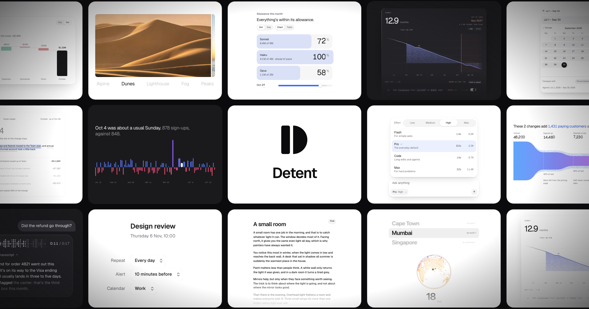
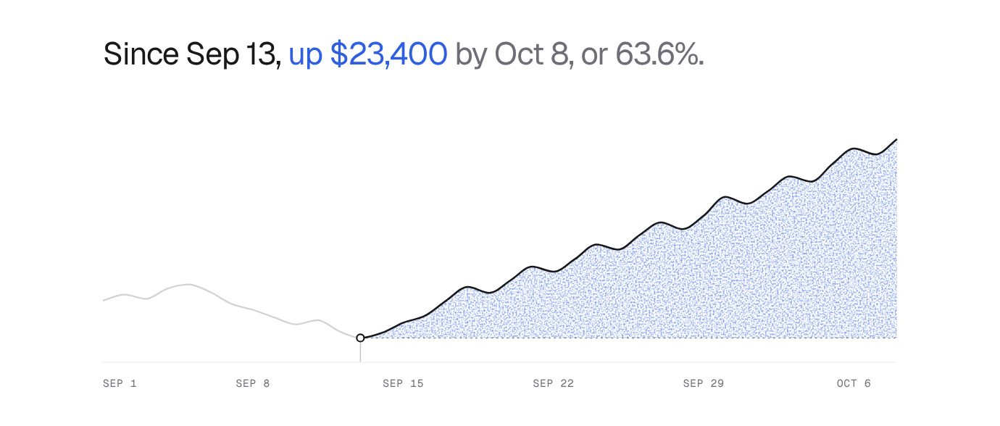
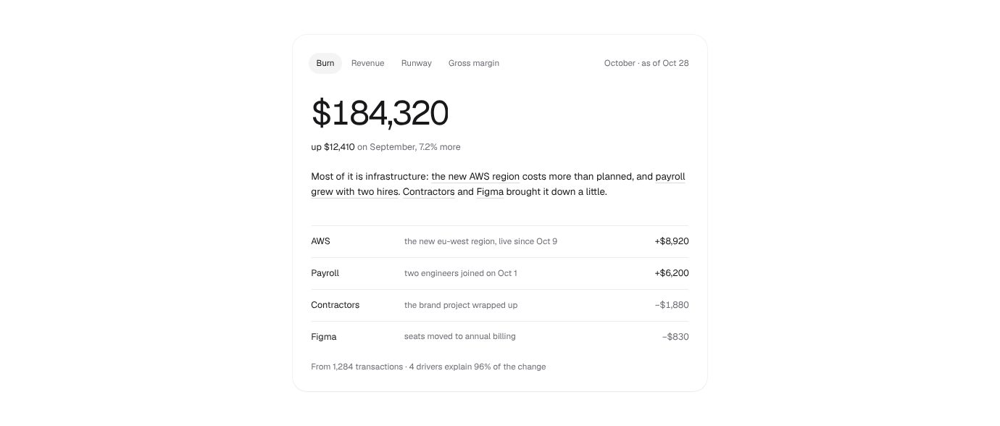
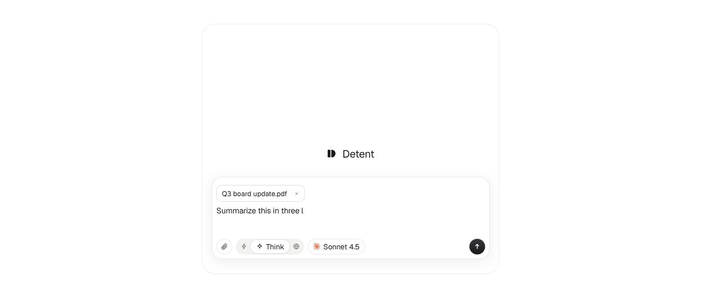
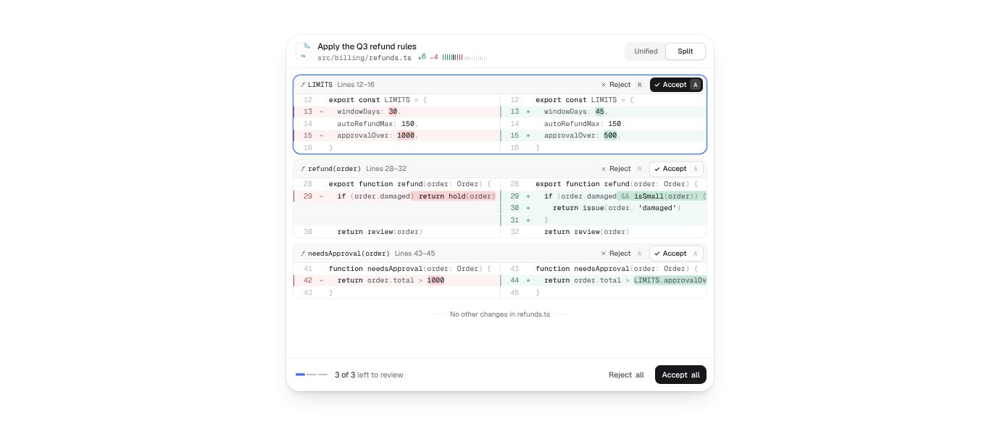
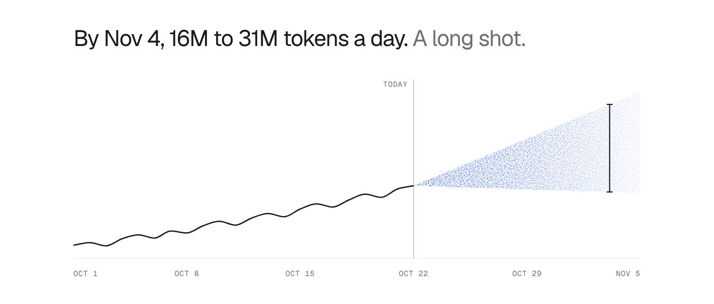
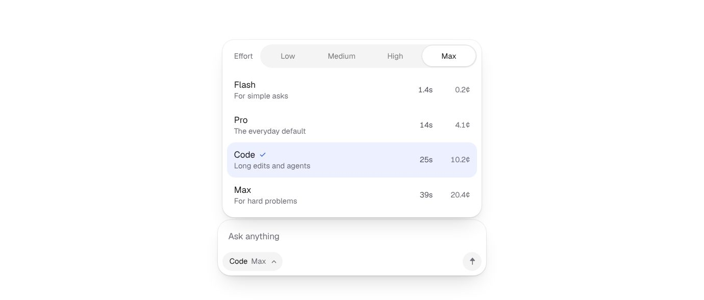

<p align="center">
  <a href="https://detentui.com">
    
  </a>
</p>

<h1 align="center">Detent UI</h1>

<p align="center">
  <strong>Animated React components for AI apps, agent interfaces and interactive charts.</strong><br />
  Install with the shadcn CLI. The source is yours to change.
</p>

<p align="center">
  <a href="LICENSE"></a>
  <a href="https://ui.shadcn.com"></a>
  
  
  
  <a href="https://github.com/ds-spec/detent-ui/stargazers"></a>
</p>

<p align="center">
  <a href="https://detentui.com">Website</a> ·
  <a href="https://detentui.com/components">Components</a> ·
  <a href="https://detentui.com/blocks">Blocks</a> ·
  <a href="https://detentui.com/docs">Docs</a> ·
  <a href="https://detentui.com/llms.txt">llms.txt</a> ·
  <a href="https://detentui.com/pro">Pro</a>
</p>

<br />

**Detent UI** is a React component library for products built on AI: prompt boxes, model pickers, diff review, voice notes, explained metrics and charts you can click into. Every piece ships with its motion, its states (loading, empty, error, where they apply) and reduced-motion support already worked out. You install it with the [shadcn CLI](https://ui.shadcn.com/docs/cli), so the TypeScript source lands in your project and you own it.

- **21 free components and 5 free blocks**, MIT licensed
- Built for **React 19**, **Tailwind CSS v4** and **Next.js** (App Router), animated with [Motion](https://motion.dev)
- Styled by your shadcn theme, light and dark
- Readable by coding agents: `llms.txt` and a markdown copy of every page

<table>
  <tr>
    <td width="50%"><a href="https://detentui.com/components/chart"></a></td>
    <td width="50%"><a href="https://detentui.com/components/metric"></a></td>
  </tr>
  <tr>
    <td><a href="https://detentui.com/components/prompt"></a></td>
    <td><a href="https://detentui.com/components/diff"></a></td>
  </tr>
  <tr>
    <td><a href="https://detentui.com/components/trend"></a></td>
    <td><a href="https://detentui.com/components/models"></a></td>
  </tr>
</table>

## Quick start

Pick a component on [detentui.com/components](https://detentui.com/components) and run its command:

```bash
npx shadcn@latest add https://detentui.com/r/popup
```

The source lands in `components/detent`. The first install also adds the Detent theme, and anything a piece depends on, such as `motion`, comes with it. Swap the name for any piece in the tables below: `npx shadcn@latest add https://detentui.com/r/<name>`.

**Requirements:** React 19 and Tailwind CSS v4. Next.js is what we test on; Vite with React works the same way.

Wrap your app once so the motion calms down for people who have asked their device for less of it:

```tsx
import { MotionConfig } from 'motion/react'

export default function RootLayout({ children }: { children: React.ReactNode }) {
  return (
    <html lang="en">
      <body>
        <MotionConfig reducedMotion="user">{children}</MotionConfig>
      </body>
    </html>
  )
}
```

## Free components

All 21 are MIT licensed. Click a name for the live demo, props and code.

### AI chat and agent UI

| Component | What it does | Install name |
| --- | --- | --- |
| [Prompt box](https://detentui.com/components/prompt) | AI chat input whose tray slides out to say what the model is doing | `prompt` |
| [Model & effort](https://detentui.com/components/models) | AI model picker: choose a model, drag how hard it thinks, see the cost | `models` |
| [Diff review](https://detentui.com/components/diff) | Review an AI agent's code change hunk by hunk, unified or split | `diff` |
| [Rewrite](https://detentui.com/components/rewrite) | Select a phrase, say how it should read, accept the AI rewrite with Tab | `rewrite` |
| [Voice note](https://detentui.com/components/voicenote) | Audio player with a waveform that inks in and a transcript that follows | `voicenote` |
| [Buddy](https://detentui.com/components/buddy) | An animated face for your AI assistant, with moods that react to the user | `buddy` |
| [AI calendar](https://detentui.com/components/week) | Week calendar where you add events by typing, with a live draft and clash warnings | `week` |

### Charts and data visualisation

| Component | What it does | Install name |
| --- | --- | --- |
| [Baseline chart](https://detentui.com/components/chart) | Interactive line chart: click any day to compare everything against it | `chart` |
| [Outlook chart](https://detentui.com/components/trend) | Forecast chart drawn as a confidence band that thins where it's less certain | `trend` |
| [Metric explainer](https://detentui.com/components/metric) | KPI card: the number, its change in words and the drivers behind it | `metric` |
| [Goal numerals](https://detentui.com/components/rings) | Goal progress as soft bars with big percentages, flicked through by month | `rings` |
| [Shift](https://detentui.com/components/shift) | Analytics breakdown as a list, bars or change, every number animating to its place | `shift` |

### Inputs and interactions

| Component | What it does | Install name |
| --- | --- | --- |
| [Popup](https://detentui.com/components/popup) | Radial context menu that opens around your finger: press, slide, let go | `popup` |
| [Phrase](https://detentui.com/components/phrase) | Settings written as one sentence, with words to pick and numbers to drag | `phrase` |
| [Rewind](https://detentui.com/components/rewind) | Textarea with history you can scrub back through, deleted words returning in colour | `rewind` |
| [Upload](https://detentui.com/components/upload) | File upload dropzone: files tip the folder open and fall in as sheets | `upload` |
| [Live list](https://detentui.com/components/livelist) | Real-time collaborative checklist, each item arriving with who added it | `livelist` |
| [Vault](https://detentui.com/components/vault) | Web3 deposit and withdraw card with every wallet and chain state handled | `vault` |

### Text and background effects

| Component | What it does | Install name |
| --- | --- | --- |
| [Halo bands](https://detentui.com/components/halo) | Glow background that restarts at every curved edge and follows the pointer | `halo` |
| [Announcement pill](https://detentui.com/components/announce) | The badge above a hero headline, with a line of light that runs round it once | `announce` |
| [Slice text](https://detentui.com/components/slices) | Animated text: strips fly in, align into letters, then cut apart around the pointer | `slices` |

## Free blocks

Whole page sections, built from the components and wired up.

| Block | What it is | Install name |
| --- | --- | --- |
| [FAQ](https://detentui.com/blocks/faq) | FAQ section, searched as you type | `faq` |
| [Testimonials](https://detentui.com/blocks/testimonials) | Testimonial section with the numbers behind each quote | `testimonials` |
| [Integrations](https://detentui.com/blocks/integrations) | Integrations grid: your stack, through glass | `integrations` |
| [Sign in](https://detentui.com/blocks/sign-in) | Sign-in page: one press, or a code by email | `sign-in` |
| [Call to action](https://detentui.com/blocks/cta) | CTA section: one line, and an email field to start | `cta` |

## Use Detent UI with coding agents

Detent is set up so Cursor, Claude Code, Codex, Copilot and other agents install the right piece with the right props instead of guessing.

- **llms.txt:** point your agent at [`detentui.com/llms.txt`](https://detentui.com/llms.txt). It lists every component with the command that installs it. Add `.md` to any page address for a markdown version.
- **Context7:** indexed at [context7.com/ds-spec/detent-ui](https://context7.com/ds-spec/detent-ui) for agents that use it for docs.

## Detent Pro

For teams shipping an AI product who want the whole screen, not only the parts. One payment, every update for life, unlimited projects.

- **21 more components**, including a trace viewer for agent runs, extraction review, ask-your-data charts, a radar chart, lasso scatter plot, dot histogram, funnel and revenue bridge (waterfall) charts, a date range picker, an emoji picker, an agent wallet, a support chat and MCP install, which writes the real config for Cursor, Claude Code, Windsurf and Zed
- **14 full-screen blocks**: agent dashboard, agent chat, evals, code review, task to merge, incident, support inbox, data table, calendar, voice mode, settings, onboarding, metered pricing and live features
- **2 templates**: an AI agent workspace app (sessions, a thread that shows its work, approvals, a composer with tools and skills) and Dusk, a landing page for an AI agent

See everything and the current price at [detentui.com/pro](https://detentui.com/pro).

Pro source lives in a private repository. Without it, this one still builds and runs: each Pro preview becomes a locked stand-in from `src/locked`.

## FAQ

<details>
<summary><strong>Is Detent UI free?</strong></summary>
<br />

Yes. The 21 components and 5 blocks listed above are free and MIT licensed, for personal and commercial projects. Detent Pro is a one-time purchase for the additional pieces.

</details>

<details>
<summary><strong>How is Detent UI different from shadcn/ui?</strong></summary>
<br />

shadcn/ui gives you the primitives: buttons, dialogs, inputs. Detent builds on the same CLI and theme to give you the finished, interactive pieces an AI product needs, such as a prompt box, a model picker, diff review and explained charts. They work side by side in the same project.

</details>

<details>
<summary><strong>Does it work without Next.js?</strong></summary>
<br />

Yes. The components are React 19 with Tailwind CSS v4. Next.js is what we test on; Vite with React works the same way, with the install paths adjusted.

</details>

<details>
<summary><strong>Does it support dark mode and reduced motion?</strong></summary>
<br />

Yes. Every piece follows your shadcn theme in light and dark, and respects `prefers-reduced-motion` through Motion's `MotionConfig`.

</details>

<details>
<summary><strong>Can my coding agent use it?</strong></summary>
<br />

Yes. See [Use Detent UI with coding agents](#use-detent-ui-with-coding-agents).

</details>

## Run the site locally

```bash
git clone https://github.com/ds-spec/detent-ui.git
cd detent-ui
npm install
npm run dev
```

| Folder | What's in it |
| --- | --- |
| `src/lab` | The free components and blocks, their demos, and the motion they share |
| `src/catalog` | What every piece is, and the registry the shadcn CLI installs from |
| `src/site` | The website around them: gallery, pages and code browser |
| `src/app` | The Next.js routes |

## Issues and feedback

Found a bug or something that feels off? [Open an issue](https://github.com/ds-spec/detent-ui/issues). Small, specific reports help most: what you did, what you expected, and what happened.

If Detent saved you time, a ⭐ helps other developers find it.

## Licence

The free components and this site's code are [MIT](LICENSE). Detent Pro has its own [licence](https://detentui.com/licence).
