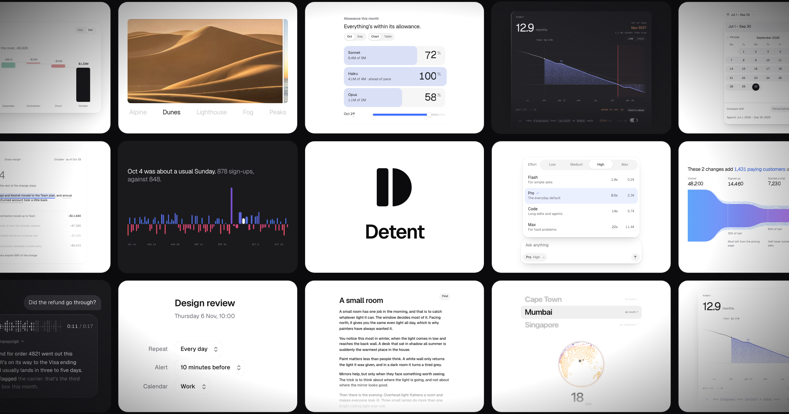

<p align="center">
  <a href="https://detentui.com">
    
  </a>
</p>

<h1 align="center">Detent</h1>

<p align="center">
  React components with the motion and the states already worked out.<br />
  Install one with the shadcn CLI and the source is yours to change.
</p>

<p align="center">
  <a href="https://detentui.com">Website</a> ·
  <a href="https://detentui.com/components">Components</a> ·
  <a href="https://detentui.com/docs">Docs</a> ·
  <a href="https://detentui.com/pro">Pro</a>
</p>

<br />

## Install

Pick a component on [detentui.com](https://detentui.com/components) and copy its command:

```bash
npx shadcn add https://detentui.com/r/popup
```

The source lands in `components/detent`, ready to change. The first install also brings the Detent theme, and anything a piece needs, like `motion`, comes with it.

You need React 19 and Tailwind CSS v4. Next.js is what we test on.

Wrap your app once so everything calms down for people who have asked their device for less motion:

```tsx
import { MotionConfig } from 'motion/react'

export default function RootLayout({ children }) {
  return (
    <html lang="en">
      <body>
        <MotionConfig reducedMotion="user">{children}</MotionConfig>
      </body>
    </html>
  )
}
```

## Free components

All 16 are MIT licensed.

| Component | What it does | Install |
| --- | --- | --- |
| [Popup](https://detentui.com/components/popup) | A menu that opens around your finger: press, slide, let go | `popup` |
| [Phrase](https://detentui.com/components/phrase) | Settings written as one sentence, with words to pick and numbers to drag | `phrase` |
| [Rewind](https://detentui.com/components/rewind) | A textarea you can scrub back through, deleted words returning in colour | `rewind` |
| [Upload](https://detentui.com/components/upload) | Files tip the folder open and fall in as sheets | `upload` |
| [Prompt box](https://detentui.com/components/prompt) | A composer whose tray slides out to say what it's doing | `prompt` |
| [Model & effort](https://detentui.com/components/models) | Pick a model, then drag how hard it thinks and see what it costs | `models` |
| [Diff review](https://detentui.com/components/diff) | An agent's change, reviewed hunk by hunk, unified or split | `diff` |
| [Rewrite](https://detentui.com/components/rewrite) | Select a phrase, say how it should read, accept it with Tab | `rewrite` |
| [Voice note](https://detentui.com/components/voicenote) | A waveform that inks in as it plays, with a transcript that follows | `voicenote` |
| [Baseline chart](https://detentui.com/components/chart) | Click any day to make it the level everything else is read against | `chart` |
| [Outlook chart](https://detentui.com/components/trend) | A forecast drawn as a band that thins where it's less certain | `trend` |
| [Goal numerals](https://detentui.com/components/rings) | Goals as soft bars with big percentages, flicked through by month | `rings` |
| [Metric explainer](https://detentui.com/components/metric) | A number, its change in words, and the drivers behind it | `metric` |
| [Halo bands](https://detentui.com/components/halo) | A glow that restarts at every curved edge and follows the pointer | `halo` |
| [Announcement pill](https://detentui.com/components/announce) | The pill above a headline, with a line of light that runs round it once | `announce` |
| [Slice text](https://detentui.com/components/slices) | Strips fly in and align into letters, then cut apart around the pointer | `slices` |

Swap the name into the command: `npx shadcn add https://detentui.com/r/<name>`.

### Free blocks

Whole sections, built from the components and wired up.

| Block | What it is | Install |
| --- | --- | --- |
| [FAQ](https://detentui.com/blocks/faq) | Answers, searched as you type | `faq` |
| [Testimonials](https://detentui.com/blocks/testimonials) | Quotes with the numbers behind them | `testimonials` |
| [Integrations](https://detentui.com/blocks/integrations) | Your stack, through glass | `integrations` |
| [Sign in](https://detentui.com/blocks/sign-in) | One press, or a code by email | `sign-in` |
| [Call to action](https://detentui.com/blocks/cta) | One line, and an email to start | `cta` |

## With a coding agent

Point Cursor, Claude Code or any agent at [`detentui.com/llms.txt`](https://detentui.com/llms.txt). It lists every component with the exact command that installs it, so the agent doesn't have to guess. Every page also has a markdown version: add `.md` to its address.

## Detent Pro

15 more components, 12 whole-screen blocks and a full app template, with more on the way. One payment, every update for life. See [detentui.com/pro](https://detentui.com/pro).

Pro source lives in a private repository. Without it, this one still builds and runs: each Pro preview becomes a locked stand-in from `src/locked`.

## Run the site

```bash
npm install
npm run dev
```

| Folder | What's in it |
| --- | --- |
| `src/lab` | The free components and blocks, their demos, and the motion they share |
| `src/catalog` | What every piece is, and the registry the CLI installs from |
| `src/site` | The website around them: gallery, pages and code browser |
| `src/app` | The routes |

## Issues

Found a bug or something that feels off? [Open an issue](https://github.com/ds-spec/detent-ui/issues). Small, specific reports are the most useful: what you did, what you expected, and what happened.

## Licence

The free components and this site's code are [MIT](LICENSE). Detent Pro has its own [licence](https://detentui.com/licence).
